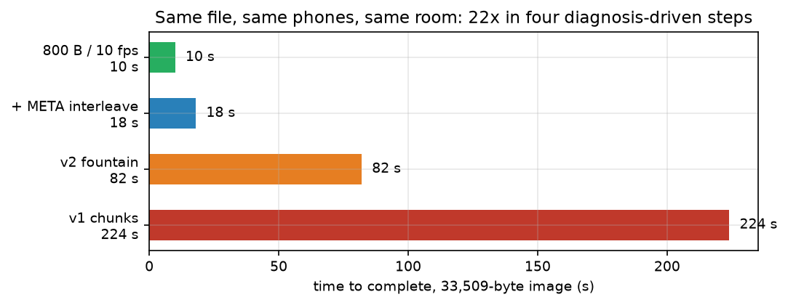
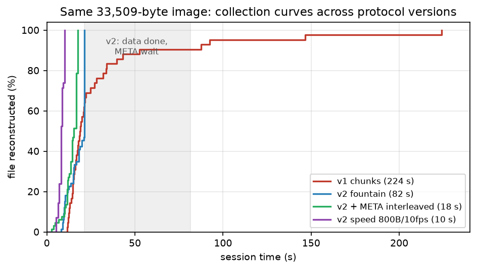
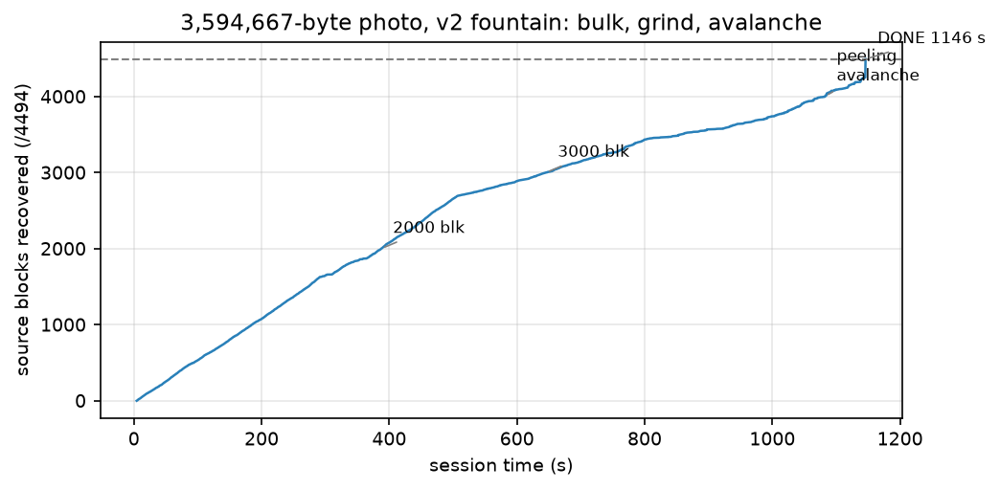
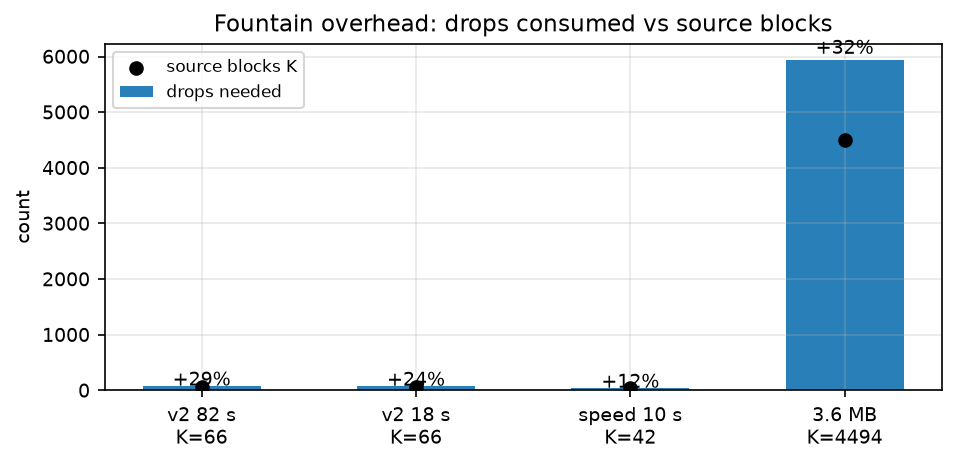
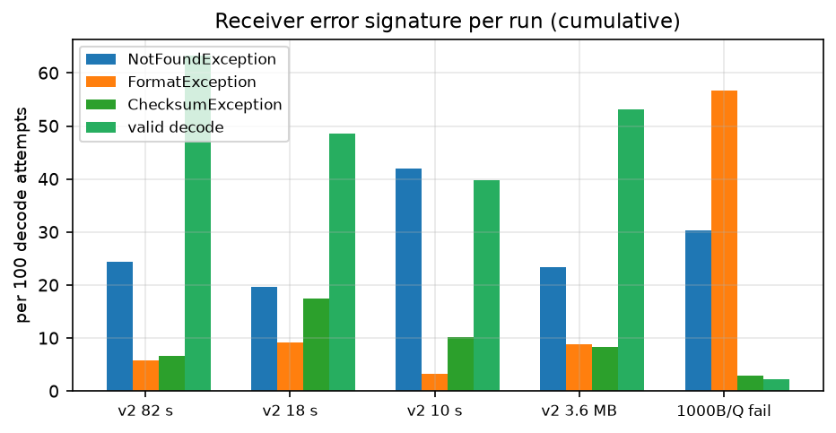
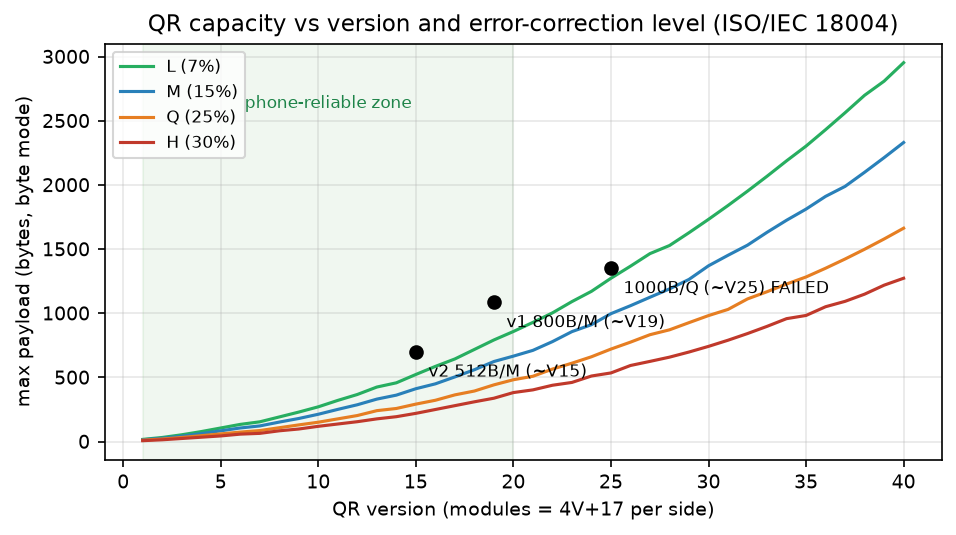

# 📸 QR Image Transfer

Send images (or any file) from a screen to a phone camera — no cable, no pairing, no network. The sender plays the
image as a stream of QR codes; the phone films it and rebuilds the file, verified by SHA-256.

 

**Measured:** 33 KB image in **10 s**, 3.6 MB photo in **19 min** — SHA-256 verified, zero installs, zero backend.

---

## How it works

```text
SENDER (laptop browser)                PHONE (mobile browser)
file ──► split ──► QR encode ──► loop ━━━ optical ━━━► camera ──► decode ──► reassemble ──► ✅ SHA-256
         ▲ v2: LT fountain drops                       any ~K(1+ε) drops suffice — no frame is special
```

Two protocols, auto-detected by the receiver:

| | v1 chunks | **v2 fountain (default)** |
|---|---|---|
| Unit | fixed indices `0..N-1` | endless unique XOR drops (LT codes, robust soliton) |
| Tail behavior | waits on *specific* missing frames (coupon collector) | **any** K(1+ε) drops complete the file |
| META | once per loop | interleaved every 20 frames |

## Results at a glance

Same 33.5 KB image, same phones, same room — 224 s → 10 s (22×) in four diagnosis-driven steps:



Collection curves: v1 crawls the tail; v2 finishes data in 13 s but waits 60 s on a once-per-pass META
(shaded); interleaving META removes the wait:



The 3.6 MB photo: linear bulk (~5 blocks/s), mid grind, then the peeling avalanche 4,003 → 4,494 in 64 s:



Fountain overhead stays 12–32% from K = 42 to K = 4,494 blocks:



Per-run decode-error signatures — the failed dense-Q run (far right) is dominated by `FormatException`:
the sensor can't even locate V25 finders, proving a hard optical wall, not a software bug:



Where each config sits on the QR capacity map (green = reliably phone-decodable):



## Quickstart

```bash
npm install
npm run dev:https          # HTTPS on LAN (phone cameras require it)
```

| Page | Open | On |
|---|---|---|
| Sender | `https://localhost:5173/sender.html` | laptop |
| Receiver | `https://<laptop-LAN-IP>:5173/receiver.html` | phone (same Wi-Fi) |

Accept the self-signed cert warning once on each device. Then:

1. **Laptop** — pick a file (or type text), keep defaults (v2 · 800 B · 10 fps · M), **Start loop**, fullscreen it, brightness max.
2. **Phone** — **Start camera**, allow, point at the screen from ~25 cm. Tap once to lock focus.
3. Watch `blocks recovered` climb → `DONE sha256 match` → preview/download. One tap on
   **Download report (.txt)** saves full session telemetry.

> First try the defaults on a small image. A 2–4 MB photo takes ~15–20 min on mid-range phones
> (≈3 kB/s net) — start it and walk away. See [`docs/BENCHMARK.md`](docs/BENCHMARK.md) for measured runs.

## Settings that matter

| Control | Default | Notes |
|---|---|---|
| Proto | v2 fountain | v1 kept for comparison |
| Block | 800 B | 512 = easier QRs; 1000+ needs good optics (fails on weak sensors) |
| FPS | 10 | 6–8 if the phone struggles; 12 max |
| ECC | M | Q only helps with strong cameras + close range |
| QR px | 720 | integer-scaled modules, pixelated upscale (fixes systematic misreads) |

## Repo map

```text
src/protocol.ts    v1 codec: chunking, CRC-16, base64url, SHA-256
src/fountain.ts    v2 codec: LT drops, robust soliton, peeling decoder
src/sender.ts      QR loop player (chained scheduling = full frame dwell)
src/receiver.ts    camera scanner (ZXing), reassembly, reports
test/              7 unit + lossy-channel simulation tests (40% loss, mid-join)
docs/              methodology, benchmark log, full scientific paper (PDF)
```

```bash
npm test     # vitest — protocol round-trips + fountain recovery under loss
npm run build
```

## Telemetry

The receiver logs every novel arrival with timestamps, 2-second counter snapshots, and a decode-error
histogram (`NotFound` = optics, `Checksum/Format` = module readability). Share the `.txt` to diagnose any run.

## Limits (measured, not guessed)

- ~3 kB/s net on the test phone → minutes per megabyte; thermal throttle after ~3 min continuous decode.
- Density ceiling on weak sensors: V25-Q undecodable (2% decode, finder patterns unlocatable).
- Integrity without confidentiality — anyone in line-of-sight can capture; encrypt before sending if that matters.

## Docs

- [`docs/QR_IMAGE_TRANSFER_METHODOLOGY.md`](docs/QR_IMAGE_TRANSFER_METHODOLOGY.md) — protocol spec + experimental design
- [`docs/QR_Image_Transfer_Scientific_Paper.pdf`](docs/QR_Image_Transfer_Scientific_Paper.pdf) — full paper: QR theory, fountain math, all results with figures
- [`docs/BENCHMARK.md`](docs/BENCHMARK.md) — every measured run

## License

MIT — see [LICENSE](LICENSE). Built on [qrcode](https://www.npmjs.com/package/qrcode),
[@zxing/browser](https://github.com/zxing-js/browser) and [js-sha256](https://www.npmjs.com/package/js-sha256).
